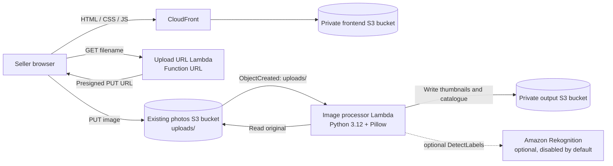

# SurplusBite

SurplusBite is a serverless photo-upload and image-processing prototype for surplus-food sellers. A seller chooses a JPG or PNG in a browser; the browser requests a short-lived presigned S3 upload URL, uploads directly to S3, and an S3 event invokes a Python Lambda to create small thumbnails and update a JSON catalogue.

> **Stage:** development prototype. The deployed upload flow has been verified end to end. It is not yet a production marketplace: there is no user authentication, listing management, public image delivery, durable catalogue database, or upload abuse protection.

## Contents

- [Architecture](#architecture)
- [Current AWS development environment](#current-aws-development-environment)
- [Repository layout](#repository-layout)
- [How uploads work](#how-uploads-work)
- [Image-processing behavior](#image-processing-behavior)
- [Prerequisites](#prerequisites)
- [Run locally](#run-locally)
- [Deploy or update AWS](#deploy-or-update-aws)
- [Verify a deployment](#verify-a-deployment)
- [Configuration reference](#configuration-reference)
- [Security and privacy](#security-and-privacy)
- [Costs and cleanup](#costs-and-cleanup)
- [Known limitations and next steps](#known-limitations-and-next-steps)
- [Troubleshooting](#troubleshooting)

## Architecture



The input and output buckets are intentionally different. The S3 notification listens only to the input bucket's `uploads/` prefix. Do not configure the output bucket to invoke the processor: doing so can create a recursive event loop.

## Current AWS development environment

The SAM stack is deployed as `surplusbite-dev` in **eu-west-1**. The region is required because the existing photo bucket is located there; an S3 bucket notification and its Lambda target must be in the same region.

| Component | Current development configuration |
|---|---|
| Upload page | `https://d19a31sgm2plos.cloudfront.net/upload.html` |
| Frontend S3 bucket | `surplusbite-frontend-405034826598` (existing; shared with other site files) |
| CloudFront distribution | `E207WXFOU8ZGXL` |
| Source/upload bucket | `surplusbite-photos-405034826598` (existing) |
| Upload prefix | `uploads/` |
| SAM stack | `surplusbite-dev` |
| Output bucket | `surplusbite-dev-outputbucket-cnimnyxfiv0a` (created by the stack; private) |
| Upload URL function | `surplusbite-dev-UploadUrlFunction-QiRCuNz7YGWL` |
| Image processor function | `surplusbite-dev-ImageProcessorFunction-i1BRJ8Ksm0xl` |
| Optional Rekognition | Disabled (`EnableRekognition=false`) |

These are development environment values, not reusable defaults for every AWS account. The source bucket and CloudFront resources are pre-existing and are not created or deleted by this SAM stack. The current account must have permission to manage the stack and access those resources.

## Repository layout

```text
.
├── template.yaml                       # AWS SAM / CloudFormation infrastructure
├── DEPLOY.md                           # concise deployment and integration runbook
├── backend/
│   ├── lambda_function.py              # image processing and S3 event handler
│   ├── upload_url_lambda.py            # presigned URL endpoint handler
│   └── requirements.txt                # Lambda processor dependency (Pillow)
├── frontend/
│   ├── upload.html                     # photo upload page
│   ├── index.js                        # browser upload workflow
│   └── styles.css                      # upload page styles
├── scripts/
│   ├── build-sam.ps1                   # stage Linux dependencies and lint SAM
│   └── integrate-existing-site.ps1     # configure existing S3/CloudFront integration
└── tests/
    ├── generate_test_images.py         # creates synthetic test files
    ├── test_local.py                   # offline image processing checks
    └── test_cases.md                   # cloud test scenario checklist
```

The PowerShell build helper creates ignored `backend/url_package/` and `backend/processor_package/` directories. They are generated deployment artifacts and should not be committed.

## How uploads work

1. `frontend/upload.html` loads `styles.css` and `index.js` from the CloudFront site.
2. `index.js` makes a browser `GET` request to the upload Lambda Function URL, passing the selected filename as a query parameter.
3. `backend/upload_url_lambda.py` strips path components from the filename, permits `.jpg`, `.jpeg`, and `.png`, creates a unique key under `uploads/`, and returns a presigned S3 `PUT` URL that expires after five minutes.
4. The browser uploads the image bytes directly to the source bucket with `Content-Type` set to the selected file's MIME type. No AWS credentials are placed in the browser.
5. The S3 `ObjectCreated` notification filtered to `uploads/` invokes `backend/lambda_function.py`.
6. The processor reads and validates the image, creates card and pin thumbnails, and stores them plus `catalogue/index.json` in the private output bucket.
7. Rekognition is called only if the stack parameter enables it. Otherwise the catalogue category status is `disabled`.

## Image-processing behavior

- Accepted filename extensions: `.jpg`, `.jpeg`, `.png` (case-insensitive).
- Accepted decoded image formats: JPEG and PNG. Renaming an unsupported or corrupt file does not make it valid.
- Card thumbnail maximum dimension: **300 × 300 px**.
- Pin thumbnail maximum dimension: **96 × 96 px**.
- Aspect ratio is preserved; small inputs are not enlarged.
- PNG palette/alpha images are converted to RGB before JPEG output when needed; PNG input remains PNG output.
- Generated keys are `thumbnails/<upload-id>_card.<ext>` and `thumbnails/<upload-id>_pin.<ext>`.
- Catalogue object key: `catalogue/index.json`. It currently retains up to 50 entries.
- Optional category suggestions use Amazon Rekognition `DetectLabels` and a basic food-label taxonomy. These are suggestions, not verified food classification.

## Prerequisites

For the current Windows development setup:

- AWS CLI v2, authenticated to the intended AWS account.
- AWS SAM CLI.
- PowerShell 5.1 or PowerShell 7.
- Python and pip available as `python` / `python -m pip` in the PowerShell session.
- Node.js for the frontend syntax check (`node --check`).
- Permission to deploy CloudFormation/IAM/Lambda/S3 resources and update the existing source/frontend buckets and CloudFront distribution.

Docker is **not required** for the current packaging script. It downloads a Linux-compatible CPython 3.12 x86_64 Pillow wheel, rather than using a Windows-native Pillow binary. The deployed Lambdas use Python 3.12 on x86_64.

## Run locally

The image processing tests require Pillow. In VS Code, select the project Python environment, then run:

```powershell
python -m pip install -r backend/requirements.txt
python tests/generate_test_images.py
python tests/test_local.py
```

Expected result: `PASSED — 4 file(s) checked`. The tests operate on synthetic local images and do not upload files or call AWS. Generated test images live in `tests/test_images/`, which is git-ignored.

Check JavaScript syntax with:

```powershell
node --check frontend/index.js
```

## Deploy or update AWS

The complete resource definition is in [template.yaml](template.yaml). A shorter operational checklist is in [DEPLOY.md](DEPLOY.md).

### 1. Confirm identity and region

```powershell
aws sts get-caller-identity
aws s3api get-bucket-location --bucket surplusbite-photos-405034826598
```

Make sure the reported account is the intended one. The existing photo bucket and stack are in `eu-west-1`; do not deploy this stack in another region while reusing that bucket.

### 2. Prepare and validate the Lambda packages

From the repository root:

```powershell
./scripts/build-sam.ps1
```

This recreates the generated package folders, copies the handlers, vendors Pillow's Linux wheel into the processor package, and runs SAM validation/lint. It intentionally does **not** run `sam build`: on Windows, SAM's build step may filter out Linux-native Pillow extensions. Deploy the staged packages directly from `template.yaml` instead.

### 3. Deploy the SAM stack

```powershell
sam deploy `
  --template-file template.yaml `
  --stack-name surplusbite-dev `
  --region eu-west-1 `
  --capabilities CAPABILITY_IAM `
  --resolve-s3 `
  --parameter-overrides `
    SourceBucket=surplusbite-photos-405034826598 `
    FrontendOrigin=https://d19a31sgm2plos.cloudfront.net `
    EnableRekognition=false `
  --no-confirm-changeset `
  --no-fail-on-empty-changeset
```

Review the CloudFormation change set before deploying in a production workflow. The `--no-confirm-changeset` option is used here for repeatable development deployments; omit it when you want SAM to pause for review. `--resolve-s3` lets SAM create/use its managed artifact bucket to upload Lambda packages.

The stack creates two Lambda functions, their execution roles, a Function URL for the URL generator, the S3 invoke permission, and a private output bucket. The output bucket is encrypted, versioned, blocks public access, and has `DeletionPolicy: Retain` so deleting the stack does not automatically delete the data.

### 4. Integrate the existing frontend and source bucket

After a successful stack deployment, run:

```powershell
./scripts/integrate-existing-site.ps1
```

The integration helper:

- Verifies the active AWS account and reads the stack outputs.
- Restricts source bucket CORS to the CloudFront origin.
- Configures an `s3:ObjectCreated:*` notification filtered to `uploads/`.
- Publishes `upload.html`, `styles.css`, and the configured `index.js` alongside the existing site files.
- Invalidates the CloudFront paths for those assets.
- Calls the Function URL to verify that it returns a presigned URL; it does not upload a test image.

**Notification warning:** S3 bucket notification configuration is a single document. The helper writes the SurplusBite notification configuration and would replace other existing notification entries. The bucket was checked and had no existing notifications before the initial integration. If other consumers have since been added, inspect and preserve their configuration before running the helper again.

### 5. Check stack outputs

```powershell
aws cloudformation describe-stacks `
  --stack-name surplusbite-dev `
  --region eu-west-1 `
  --query "Stacks[0].Outputs" `
  --output table
```

Important outputs include `UploadUrl`, `ImageProcessorFunctionName`, `SourceBucketName`, and `OutputBucketName`. The current frontend JavaScript contains the deployed `UploadUrl`; after replacing the stack or deploying to another account, update that value and republish the site assets.

## Verify a deployment

1. Open [the upload page](https://d19a31sgm2plos.cloudfront.net/upload.html).
2. Select a JPG or PNG and upload it.
3. Confirm the browser reports success.
4. In the source bucket, confirm the original appears under `uploads/`.
5. In the output bucket, confirm the card and pin appear under `thumbnails/` and the catalogue appears at `catalogue/index.json`.
6. Review the image processor CloudWatch log group for `Successfully processed` and `Updated catalogue` messages.

Useful CLI checks (substitute stack outputs if the stack name or environment differs):

```powershell
aws s3api list-objects-v2 `
  --bucket surplusbite-photos-405034826598 `
  --region eu-west-1 `
  --prefix uploads/

aws s3api list-objects-v2 `
  --bucket surplusbite-dev-outputbucket-cnimnyxfiv0a `
  --region eu-west-1

aws logs tail /aws/lambda/surplusbite-dev-ImageProcessorFunction-i1BRJ8Ksm0xl `
  --since 30m `
  --region eu-west-1
```

The local acceptance tests and a deployed browser upload have both been verified for the current development environment. The deployed test produced 300 × 225 and 96 × 72 thumbnails from a synthetic JPG, and updated the catalogue. Rekognition was disabled for that test.

## Configuration reference

### SAM parameters

| Parameter | Default in current template | Purpose |
|---|---|---|
| `SourceBucket` | `surplusbite-photos-405034826598` | Existing S3 bucket receiving originals. |
| `FrontendOrigin` | `https://d19a31sgm2plos.cloudfront.net` | Exact browser origin allowed by the upload Function URL and source bucket CORS. |
| `EnableRekognition` | `false` | Adds the processor's `rekognition:DetectLabels` permission and enables label calls when `true`. This may incur additional charges. |

### Lambda environment variables

| Function | Variable | Meaning |
|---|---|---|
| Upload URL generator | `SOURCE_BUCKET` | Existing bucket used to create presigned uploads. |
| Image processor | `OUTPUT_BUCKET` | Stack-managed bucket for thumbnails and catalogue. |
| Image processor | `ENABLE_REKOGNITION` | Enables optional label detection when set to the string `true`. |

### CORS responsibilities

There are two separate browser requests and CORS configurations:

- **Browser → Lambda Function URL:** allows `GET` from the exact CloudFront origin. Managed by the SAM `FunctionUrlConfig`.
- **Browser → source S3 bucket:** allows `PUT` from that same origin and allows the request headers. Configured on the existing source bucket by the integration script.

Function URL CORS does not configure S3 CORS. CORS is a browser policy, not authentication: the Function URL is public because its `AuthType` is `NONE`.

## Security and privacy

- The upload URL Lambda grants only `s3:PutObject` under `uploads/*` in the configured source bucket.
- The processor role grants source reads only under `uploads/*`, output reads/writes in the output bucket, and narrowly scoped catalogue existence access.
- Rekognition permission is added only when enabled; the AWS action does not support resource-level restriction in this policy and therefore uses `Resource: "*"`.
- The generated output bucket blocks all public access, enables S3-managed encryption and versioning, and denies non-HTTPS access.
- The browser never receives AWS credentials. Presigned URLs are bearer capabilities: anyone possessing one can use it until its five-minute expiry, for the signed object and operation.
- The Function URL currently allows unauthenticated invocation. Restrict CORS to the real site origin, but do not treat CORS as a security boundary. Before broad public use, consider authentication, request throttling/WAF, monitoring, abuse controls, and an explicit upload-size policy.
- Do not commit credentials, `.env` files, AWS profiles, access keys, or generated deployment archives. Use individual AWS identities and MFA.
- Uploaded food photos may contain personal or sensitive information. Decide retention and deletion rules before accepting real customer images.

## Costs and cleanup

The stack uses Lambda, S3, CloudFront, CloudWatch Logs, and optionally Rekognition. Costs depend on account Free Tier eligibility, traffic, storage, log retention, and region. Rekognition is disabled by default. Check the AWS Billing console and configure an AWS Budget alert; an alert notifies but does not cap spend.

The SAM-managed output bucket is retained when the stack is deleted. The existing source and frontend buckets and CloudFront distribution are not stack-owned and are not deleted by stack deletion. Before deleting the stack:

1. Disable/remove the source bucket's `uploads/` notification pointing to the processor.
2. Decide whether to preserve or explicitly remove the retained output bucket and its data.
3. Delete the `surplusbite-dev` CloudFormation stack only after reviewing retained resources and outputs.
4. Remove stale SAM artifacts from the managed packaging bucket if no longer needed, following your AWS account's retention policy.

## Known limitations and next steps

1. **Catalogue concurrency:** `catalogue/index.json` uses S3 read-modify-write. Overlapping processor invocations can overwrite one another. Move catalogue records to DynamoDB (or another concurrency-safe store) before substantial traffic. The current Lambda does not reserve concurrency because the account could not reserve one execution without violating its Lambda unreserved-concurrency minimum.
2. **Catalogue and image delivery:** the output bucket is private, and the current upload page does not display catalogues or thumbnails. Add an authorized CloudFront origin/access policy or a controlled API before presenting those assets to users.
3. **Input size enforcement:** the UI says “up to 10MB”, but the current backend does not enforce a server-side maximum size. Add a signed content-length constraint or controlled upload flow before exposing to untrusted public traffic.
4. **Public endpoint abuse:** Function URL `AuthType: NONE` has no application-level authentication, rate limiting, or user quota. CORS alone cannot prevent non-browser clients from calling it.
5. **Error/retry handling:** invalid/corrupt uploads are logged and skipped; operational alerting, retry strategy, and dead-letter handling need to be designed for production.
6. **Single environment:** the current stack and bucket configuration are for development. Use isolated dev/stage/prod resources and controlled promotions for a team/production deployment.
7. **Test coverage:** offline tests exercise image resizing and corrupt-image handling; AWS integration tests should separately verify CORS, IAM, S3 notifications, retries, and access restrictions.

## Troubleshooting

| Symptom | Likely cause | Check / fix |
|---|---|---|
| Frontend says upload service is not configured | `API_URL` is not a valid HTTPS Function URL | Check the SAM `UploadUrl` output and publish the updated `index.js`; invalidate CloudFront. |
| Browser GET to the Function URL fails | Incorrect endpoint, Function URL CORS origin mismatch, or Lambda error | Compare browser origin with `FrontendOrigin`; inspect the URL generator CloudWatch logs. |
| Presigned URL is returned, but S3 PUT fails | Source bucket CORS, expiry, signed content type, or upload role permission | Check the source bucket CORS and `s3:PutObject` policy. URLs expire after five minutes. |
| Upload succeeds but no thumbnails appear | S3 notification missing/wrong prefix, invoke permission, Lambda import/runtime error, or S3 read permission | Confirm the notification is `s3:ObjectCreated:*` with prefix `uploads/`; inspect processor logs and IAM. |
| `cannot import name '_imaging' from PIL` | Windows-built Pillow package or SAM's Windows build removed Linux binaries | Run `scripts/build-sam.ps1` and deploy directly from `template.yaml`; do not run `sam build` for this package on Windows. |
| Catalogue is not updated | Processor lacks the `ListBucket` prefix permission or catalogue JSON is invalid | Check the processor role and CloudWatch logs for `catalogue/index.json` access errors. |
| CloudFront still serves older files | Cached frontend assets | Invalidate `/upload.html`, `/styles.css`, and `/index.js` after publishing. |
| CloudFormation says a bucket name is already taken | S3 bucket names are globally unique | Reuse the intended bucket via a parameter or choose a unique name for a new stack. |

## License and privacy

No production customer images or AWS credentials belong in the repository. Local test images are synthetic and generated by `tests/generate_test_images.py`. Add a license and privacy notice before distributing the application or collecting real uploads.
